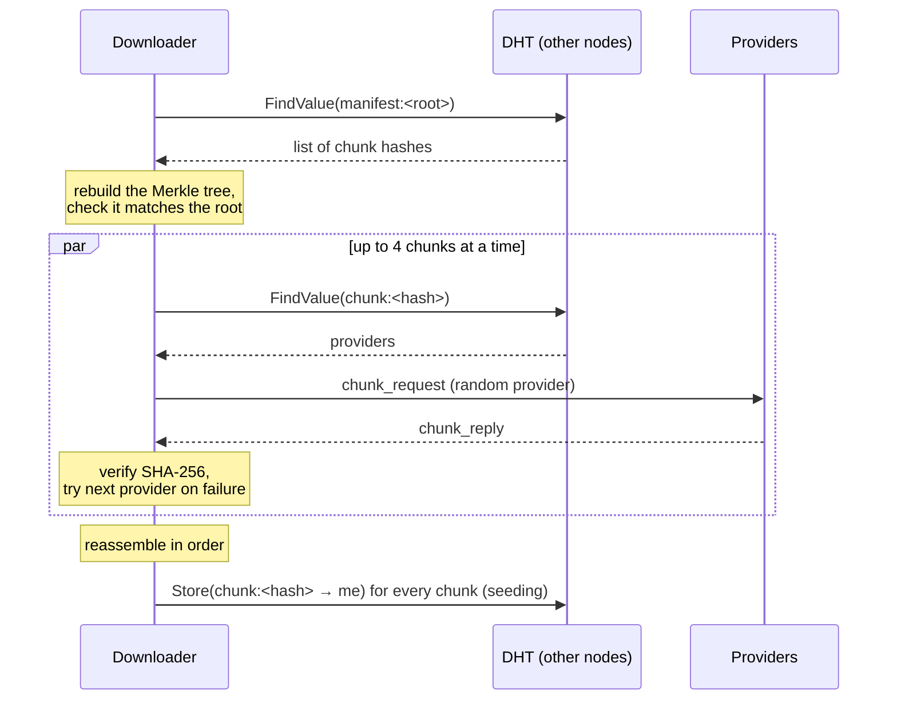

# Architecture

How p2p-lab is put together. For the plan and the decisions behind it, see
[spec.md](spec.md); for the exact wire format, [protocol.md](protocol.md).

## Overview

Every node is the same program. There is no server, coordinator or
special node: each one listens, dials its peers, and runs the same three
subsystems on top of a shared core.

```
                 HTTP API (per node)
   POST /share   GET /fetch/{root}   POST /gossip   /dht/{key}   /metrics
                                 │
     ┌───────────────┬───────────┴───────────┬───────────────┐
     │    gossip     │          dht          │   transfer    │
     │  epidemic     │  routing table,       │  chunks,      │
     │  broadcast    │  lookups, records     │  Merkle,      │
     │               │  (directory)          │  seeding      │
     └───────┬───────┴───────────┬───────────┴───────┬───────┘
             └──────── message router (by type) ─────┘
                                 │
        core: identity · TCP framing · handshake · heartbeats · reconnection
```

Transfer depends on the DHT (to find manifests and providers) and on core
(to request chunks). Gossip and the DHT depend only on core.

## Core

**Identity.** Each node has an Ed25519 key pair stored on disk. Its NodeID
is the SHA-256 of the public key: 256 bits, stable across restarts,
independent of the node's address.

**Connections.** One TCP connection per peer, carrying length-prefixed
JSON messages. In Go, each connection runs three goroutines: read, write
and heartbeat. In Python, the same three tasks run in an `asyncio.TaskGroup`.

**Handshake.** The dialing side sends a `handshake` with its NodeID; the
accepting side registers the peer and replies with its own. Only then is
the peer added to the pool, and only then do callbacks such as the DHT's
"add to routing table" run.

**Routing.** Every subsystem subscribes to its own message types and gets
its own channel. Messages with no subscriber go to a default channel.

**Failure handling.**

| Failure | Detected by | Time |
|---|---|---|
| Peer process killed | socket error (FIN/RST from the kernel) | milliseconds |
| Network partition, hung peer | no message for 6s (heartbeat every 2s) | 6–9s |
| Peer slow but alive | not treated as failure | — |

When a connection dies, the goroutine that owns it closes the socket and
removes it from the pool, but only if it is still the registered
connection for that peer, so a stale cleanup cannot remove a newer one.
Pending requests to that peer fail immediately.

**Reconnection.** Each node keeps a list of addresses to stay connected to
(its `-dial` list). A reconciliation loop runs every second, compares the
list with the live connections, and redials what is missing with
exponential backoff and jitter. In the cluster, the higher-numbered node of
each pair is the one that dials, so every pair has exactly one connection.

## Gossip

A message injected at one node reaches every node without any node
knowing the whole network.

1. The originator assigns a unique message ID and forwards the message to
   3 random peers.
2. A node receiving it drops it if the ID was already seen; otherwise it
   delivers it, decrements the TTL and, while TTL > 1, forwards it to 3
   random peers.

The payload carries the originator's send time, so every node can record
how long delivery took.

## DHT

A Kademlia-style distributed hash table. Keys and NodeIDs live in the same
256-bit space; a key is stored at the nodes whose IDs are closest to the
key's hash, by XOR distance.

**Lookup** (find the K = 8 nodes closest to a target):

1. Start from the closest known nodes.
2. Ask up to 3 of them in parallel for their closest known nodes.
3. Once the first reply arrives, wait at most 50ms for the others.
4. Add any new nodes and repeat, until a round finds nothing new.

**Store** runs a lookup for the key and sends the value to the closest
nodes, also keeping a local copy. **FindValue** walks the network the same
way, stopping as soon as some node returns the value.

Each key holds a **set** of values (up to 20). This is what lets a chunk
have several providers.

## Transfer

Files are identified by content, not by name or location.

**Share:**

```
file ──► 1MB chunks ──► SHA-256 per chunk ──► Merkle tree ──► root
                                │                               │
            DHT: chunk:<hash> → {this node}       DHT: manifest:<root> → chunk list
```

**Fetch** (the downloader only knows the root):



Nothing received from a peer is trusted: the manifest is checked against
the root, and each chunk against its hash. A dead, slow or lying provider
only means "try the next one".

## Observability

```
node ──/metrics──► Prometheus ──► Grafana (network, DHT, transfer, SLOs)
node ──OTLP──────► OTel collector ──► Tempo ──► Grafana (traces)
```

- **Metrics** cover connections, messages by type, gossip forwarding and
  duplicates, gossip delivery latency, DHT lookup latency, chunk and file
  fetch latency, bytes transferred and verification failures.
- **Traces** cover DHT lookups (one span per RPC) and file fetches (one
  span per chunk). Each node's spans form separate traces: trace context
  is not carried inside messages.

## Deployment

The local cluster (`infra/compose/cluster-5.yml`) runs five Go nodes on one
Docker bridge network plus the observability stack. Each node has its own
volume for its key file, so identities survive container restarts, and
publishes its P2P port as `700N` and its HTTP port as `910N`.

The Python node (`python/`) speaks the same protocol and can join this
cluster from the host by dialing the published ports.

## Repository map

| Path | Contents |
|---|---|
| `go/internal/common` | identity, NodeID, tracing setup |
| `go/internal/core` | framing, connections, node, routing, metrics |
| `go/internal/gossip` | epidemic broadcast |
| `go/internal/dht` | routing table, lookups, records |
| `go/internal/transfer` | chunking, Merkle trees, fetch and seeding |
| `go/cmd/node` | node binary and HTTP API |
| `go/cmd/golden` | generates wire fixtures for the Python tests |
| `python/p2plab` | Python node: wire, identity, node, gossip, dht |
| `infra/` | Dockerfile, Compose cluster |
| `observability/` | Prometheus, OTel collector, Tempo, Grafana dashboards |
| `scripts/` | SLO load generator, integration tests |
| `docs/` | spec, architecture, protocol, SLOs, chaos experiments, runbook |